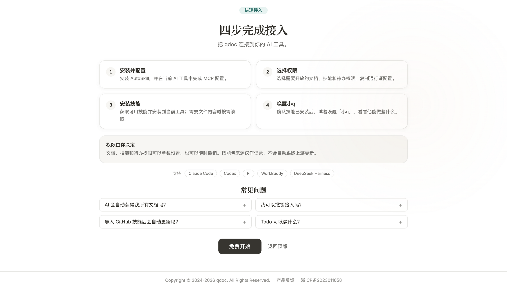

# AutoSkill

**AutoSkill 把 agent 会话里正在流失的经验，自动存进你的个人知识库**——[qdoc.chat](https://qdoc.chat)，由 AI 驱动。

你照常使用 agent（DeepSeek Harness、pi、OpenCode……）写代码、查问题、做方案，后台默默做两条链的事：

```
经验侧   会话记录 ──自动编译──▶ .qdoc/ 知识页 ──7 道门禁──▶ qdoc.chat 文档
                                  │
分发侧   agent-skills ──ow sync──▶ 平台技能市场 ──每日首次访问检查──▶ 各宿主技能目录
```

- **经验侧·自动沉淀**：会话每满 30 轮，把里面的结论、踩坑、决策编译成一篇知识页，过门禁后发布到 qdoc.chat——可搜索、可改名打标签、发出去就永久在线
- **分发侧·技能同步**：把你的 agent 技能（SKILL.md）统一装到每一家宿主，每天自动检查更新；换新机器装完即得全部技能

两条链共用一个仓库；**平台**（qdoc.chat）+ **ow CLI** + **qdoc 技能** 三件套见下文 [qdoc：平台知识中心](#qdoc平台知识中心分发侧)。

## 用起来是什么样

装好之后（见[快速开始](#快速开始)），日常会变成这样：

1. **照常干活**——不记命令、不加流程，qdoc 是加法不是负担
2. **后台自动沉淀**——会话满 30 轮自动编译；会话被压缩前先抢救尾巴；每天第一次使用自动检查技能更新
3. **想主动干预时说一句话**——对 agent 说：
   - `xq 沉淀` —— 立刻编译当前会话（`小q`/`qdoc`/`xq` 三个唤醒词等价）
   - `xq 查 部署流程` —— 检索已发布的文档
   - `xq 发布` / `xq 确认` / `xq 待办` —— 发布 / 处理待确认 / 管理待办
4. **上 [qdoc.chat](https://qdoc.chat) 收获**——仪表盘看沉淀节奏，文档页检索与分享，技能库管理分发到各家宿主的技能

## 快速开始

**pi 用户不需要 npm/pnpm install**：`ow` 和扩展都只用 Node 内置模块。

```bash
# 0. Node ≥ 22.6；ow capture 读 dsh 会话还需要内置 zstd（Node ≥22.15）或 zstd 命令
node --version
which zstd || echo "没有 zstd：只能用内置 zstd（Node ≥22.15）"

# 1. 装 pi 包：用仓库根，不要装 adapter-pi 子包
#    （root manifest 同时提供 extension + agent-skills，相对路径稳定）
pi install /path/to/AutoSkill4Personal

# 2. 一键安装：预检 → init vault → 平台技能 → 仓库技能 → ow launcher → drift
node scripts/setup.ts --host pi

# 3. 重启 pi；验证
ow doctor --host pi
```

`setup.ts` 也可用于 dsh：`node scripts/setup.ts --host dsh`，`--host all` 装 dsh+pi。
qoder / codebuddy 仍用 `npm run install-skill -- --host qoder` 等单独装。

**OpenCode**（详见 [packages/adapter-opencode/README.md](packages/adapter-opencode/README.md)）：

```bash
npm run install-skill -- --host opencode            # 技能装到 ~/.config/opencode/skills
ln -s <本仓库>/packages/adapter-opencode ~/.config/opencode/plugins/autoskill-opencode
ow doctor --host opencode
```

装完即全自动：当天第一次用户轮次会触发技能检查；会话满 30 轮自动编译知识页。

**Node 22.14 说明**：`ow` 的 status/sync/doctor 可直接用；capture 会自动退回外部 `zstd -dc`。
如果系统 `node` 太旧，用 `OW_NODE=/path/to/node scripts/ow ...` 指定。

## qdoc：平台知识中心（分发侧）

**qdoc = qdoc.chat 平台 + ow CLI + qdoc 技能** 三件套，把仓库里的知识页与 skill 变成所有 agent 随查随用的在线资产：



- **平台**（qdoc.chat）：知识文档（发布/在线查询/改名/tag）+ 待办（todo）+ 技能市场（双向同步）+ 仪表盘。关键特性：**只有发布、没有删除**（下线只能打墓碑），发出去就在线；doc_id 是 UUID，台账记录认领关系，发现不可达自动**自愈重建**；文档可见性跟账号走，token 按功能分权限（`todo:read/write` 等 scope）
- **ow CLI**（`packages/cli`）：仓库 vault（`.qdoc/`）到平台的**唯一正道**——门禁、去重、台账都在里面，手写页面会绕过全部检查。发布过 7 道本地门禁；查询本地优先 + 平台兜底、按词降级重试；待办纯透传；`mcp-config` 一键生成各宿主的 MCP 接入配置
- **qdoc 技能**（`agent-skills/qdoc`）：agent 侧的使用说明书，教 agent 正确用前两样——唤醒词、**平台事实卡**（tag ≤20 字符静默截断、`tools/list` 可能滞后、技能落库默认未启用……）、排错 playbook。五个宿主都已安装

对话里直接说（宿主 agent 按 SKILL.md 行动，无需记命令）：

| 说 | agent 做 |
|---|---|
| 「xq 沉淀」/「xq 查 X」/「xq 发布」 | `capture` / `query` / `publish` |
| 「xq 待办」/「xq 记一下 X」 | `todo list` / `todo add` |
| 「xq 状态」/「xq 确认」 | `status` / `review`（唯一不可回滚操作，必须人确认）|

（唤醒词：`小q`、`qdoc`、`xq` 等价；`xq` 是纯 ASCII 别名，中文输入法下不用切换。）

命令速查：

```bash
npm run ow --silent -- status          # 水位/待发布/预算/锁/待确认
npm run ow --silent -- capture         # 编译当前会话 → 知识页
npm run ow --silent -- publish --dry-run   # 门禁预检，再去掉 --dry-run 实发
npm run ow --silent -- query "关键词"   # 查已发布文档
npm run ow --silent -- todo list       # 平台待办
ow doc upload report.pdf               # PDF/DOCX 独立上传（20MB 上限）
ow doc download <UUID> --out ./report.pdf
ow doctor                              # 宿主接入自检（含 opencode）
```

全部命令见 `packages/cli/src/main.ts` HELP，常用流程一条龙见 [agent-skills/qdoc/references/playbook.md](agent-skills/qdoc/references/playbook.md)。

## 多宿主

技能（`agent-skills/` 下含 SKILL.md 的目录）用 `npm run install-skill` 统一装到五家宿主，同时创建 `~/.config/qdoc/bin/ow`；`--check` 验漂移：

| 宿主 | 技能目录 | 接 qdoc 平台 |
|---|---|---|
| dsh（DeepSeek Harness） | `~/.dsh/skills` | 自带 MCP 客户端 / `ow` CLI |
| pi | `~/.pi/agent/skills` | **无内置 MCP**；走 adapter-pi 扩展 + `ow` CLI |
| OpenCode | `~/.config/opencode/skills` | 插件 adapter-opencode + `ow` CLI |
| Qoder CN CLI | `~/.qoder-cn/skills` | `ow mcp-config --host qoder` 生成配置 |
| CodeBuddy Code CLI | `~/.codebuddy/skills` | `ow mcp-config --host codebuddy` |
| WorkBuddy 桌面版 | 技能市场上传 | `ow mcp-config --host workbuddy`（连接器 UI 粘贴） |

Qoder / CodeBuddy / WorkBuddy 的 MCP 配置同构（`mcpServers` + http + headers），`alwaysAllow` 只放只读工具，写操作保留逐次确认。**pi 0.84.x 没有内置 MCP**，`ow mcp-config --host pi` 会直接说明不需要配置。给新宿主单独发 token，可单独吊销。

**每日首次访问自动检查**：当天第一次有用户轮次时，宿主会做一次仓库技能漂移检查 + 平台技能拉取（状态在 `~/.config/qdoc/auto-sync.json`）。手改过的技能不会被覆盖；结果看 `ow status`。设计见 [AUTO_CHECK_2026-11-17.md](design/AUTO_CHECK_2026-11-17.md)。

## 设计上值得知道的几件事

- **幂等**：水位线按 `<agent>:<session>` 记录已编译到第几轮；同一窗口已有报告时只推进水位，不重复调 LLM
- **不覆盖手改**：技能同步只装不覆盖；推送覆盖平台同名技能必须人确认（`ow review`）
- **发布可预检**：`ow publish --dry-run` 先看门禁，实发才碰平台
- **数据隔离**：每个宿主独立数据目录（如 opencode 在 `~/.config/qdoc/knowledge/opencode`），且都在 checkout 外——宿主 update 对包内数据执行 `git clean -fdx`
- **凭据复用**：抽取引擎用宿主自己的模型凭据（pi 走 ModelRegistry；dsh 优先 `ctx.llm`；opencode 直连会话当前模型），装完即用，不用另配 API key

旧的 atoms / 知识卡片 / `compile-skills.ts` 链路仍保留为脚本与实验入口，但**不在自动主路径**；细节见 [SKILL_COMPILER.md](design/SKILL_COMPILER.md)、[STORE_PLAN.md](design/STORE_PLAN.md)。

## 配置

- token 放 `~/.config/qdoc/token`（平台分权限：`todo:read/write` 等 scope，旧 token 缺权限要重新生成勾选）
- `KB_DIR` 可覆盖知识数据目录（默认各宿主独立，如 `~/.pi/agent/data/autoskill/knowledge/`）
- 环境开关：`OW_TURNS`（编译窗口轮次）、`OW_AUTO_CHECK=0`（关每日检查）、`AUTOSKILL_AUTO_UPDATE=1`（opencode 仓库自动更新）等，见各 adapter README

## 目录结构

```
agent-skills/              # 可分发技能源（qdoc、ow-compiler），install-skill 同步到各宿主
packages/core/             # 抽取/分诊/整合/编译/打包引擎 + qdoc 发布器/同步/门禁（零宿主依赖）
packages/cli/              # ow 命令行（capture/publish/query/doc/todo/sync/mcp-config/...）
packages/adapter-pi/       # pi 宿主适配层（extensions 入口 + skills 约定）
packages/adapter-dsh/      # dsh 宿主适配层
packages/adapter-opencode/ # OpenCode 插件（prompt/idle/compaction 触发 + qdoc_capture 工具）
.qdoc/                     # 知识页 vault（index/hot/references/skills/journal + .publish/ 台账）
scripts/setup.ts           # 一键宿主安装（pi/dsh）
scripts/install-skill.ts   # 五宿主技能安装/漂移检查
design/                    # 原理与设计文档（见下）
```

## 详细文档

| 文档 | 内容 |
|---|---|
| [EXTRACTION_QDOC_PLAN_2026-11-13.md](design/EXTRACTION_QDOC_PLAN_2026-11-13.md) | **平台链路主文档**：通路/能力边界（实测）/同步/冲突/命令面/多宿主（§10.7b） |
| [SKILL_COMPILER.md](design/SKILL_COMPILER.md) | 技能编译管线与校验器 |
| [STORE_PLAN.md](design/STORE_PLAN.md) | 知识卡片准入三问与数据模型 |
| [EXTRACTION_PRINCIPLES.md](design/EXTRACTION_PRINCIPLES.md) | 抽取原则（历史三轴设计保留于此） |
| [INTEGRATE_GUIDE.md](design/INTEGRATE_GUIDE.md) | agent 整合提案写法 |
| [AUTO_CHECK_2026-11-17.md](design/AUTO_CHECK_2026-11-17.md) | 每日首次访问自动检查（替代固定定时器） |
